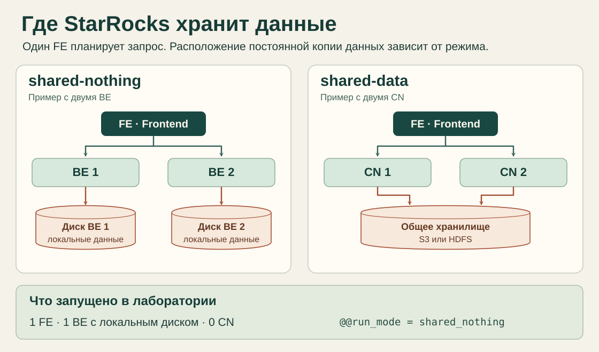

# Аналитические базы и архитектура StarRocks

[Слайды занятия (PDF)](slides.pdf)

**Видео 38 минут · самостоятельная практика 45 минут после подготовки стенда · StarRocks 4.1.4.** После занятия вы сможете объяснить, почему поиск одного чека и отчёт за смену создают разную нагрузку, выбрать между двумя режимами хранения StarRocks и найти в работающей базе узлы, которые выполняют ваш запрос.

## 1. Два вопроса к одной таблице

Гость просит восстановить чек №102. Кассир хочет узнать, какой напиток там был и сколько чашек оплатили. Управляющий задаёт другой вопрос: сколько чашек приготовили **за 3 января**? Для ответа кассиру достаточно одной записи. Для отчёта нужно найти все подходящие продажи и сложить числа.

| Чек | Дата | Кофе | Чашки |
| ---: | --- | --- | ---: |
| 100 | 2026-01-02 | espresso | 4 |
| 101 | 2026-01-03 | latte | 2 |
| 102 | 2026-01-03 | espresso | 1 |
| 103 | 2026-01-03 | latte | 3 |

Первый ответ — **№102, один эспрессо**. Второй — **2 + 1 + 3 = 6 чашек**. Чек №100 относится к предыдущему дню. Если в отчёте получилось 10, посчитаны обе даты. В этом учебном наборе на один чек приходится одна строка с одним видом напитка.

### OLTP и OLAP

**OLTP** (online transaction processing) — обработка операций приложения: зарегистрировать продажу, провести возврат, достать конкретный заказ. Для кассы важно, чтобы связанные изменения завершились целиком, а покупатель быстро получил подтверждение. Индекс по номеру чека помогает найти конкретную запись. **OLAP** (online analytical processing) — анализ множества записей: посчитать объём продаж, сгруппировать по дням, сопоставить с планом. Для такого отчёта важны время ответа, свежесть данных и число людей, которые смогут открыть его одновременно.

Одна СУБД может выполнять оба запроса. PostgreSQL с подходящим индексом способен найти чек и выполнить `SUM` для отчёта. Если отчёты начинают читать большой объём истории одновременно с работой касс, измерьте влияние на время оформления покупки. У отдельной аналитической базы тоже есть цена: изменения нужно перенести, а отчёту — сообщить, насколько он отстаёт от источника.

### Строки, колонки и вычисление суммы

В типичном строковом хранении поля одной записи лежат рядом: **102 · 3 января · espresso · 1**. Это удобно, когда приложение читает чек целиком. В колоночном хранении значения каждого поля хранятся группами. В упрощённом представлении для четырёх чеков колонка дат выглядит как `[2 янв., 3 янв., 3 янв., 3 янв.]`, колонка количества — `[4, 2, 1, 3]`. Сравнение дат с 3 января выбирает позиции 2, 3 и 4. Сложение чисел на этих позициях даёт 6.

Запрос `SUM(cups)` с условием по `sale_day` обращается к двум из четырёх колонок таблицы. Для чтения всего чека потребовались бы и другие поля. Повторяющиеся даты могут хорошо сжиматься, а обработка нескольких значений за один проход называется **векторизованным исполнением**. Степень сжатия зависит от данных и кодирования. Сокращение числа полей с четырёх до двух само по себе не обещает двукратного ускорения. На четырёх строках мы проверяем смысл запроса; скорость сравнивают на представительном объёме данных.

## 2. Когда выбирать аналитическую систему

Начните с пяти вопросов. Кто записывает данные? Через какое время после продажи она должна попасть в отчёт? Сколько истории читается? Сколько запросов выполняется одновременно? Кто обслуживает систему и за что команда платит? У одного магазина и у сети ответы могут различаться.

| Кандидат | Подходящая проверка на своей задаче |
| --- | --- |
| PostgreSQL | Справляется ли текущая база с платежами, поиском по индексу и нужным числом отчётов в час? Сравните задержку кассы во время тяжёлого отчёта. |
| DuckDB | Для анализа выгрузки одним Python-процессом проверьте, хватает ли ресурсов ноутбука. Движок можно встроить в приложение. |
| ClickHouse | Для аналитики событий проверьте колоночные чтения на реальных фильтрах, объединениях и обновлениях. |
| BigQuery | Если команда предпочитает управляемый сервис, измерьте затраты своего объёма запросов, загрузок и хранения в облаке. |
| StarRocks | Для общего SQL-сервиса проверьте параллельные отчёты, соединения таблиц, частые исправления и доступ к данным в озере. Учтите стоимость эксплуатации кластера. |

У сети кафе, например, продажи приходят непрерывно, а справочник магазинов содержит их города. В StarRocks `JOIN` связывает чеки со справочником для отчёта по городам. Распределённое исполнение **MPP** позволяет разделить работу между несколькими вычислительными узлами. Пересылка данных между ними тоже требует времени. Таблица **Primary Key** принимает обновление строки по её ключу, если касса присылает исправленный чек. Частый отчёт можно заранее рассчитать в **материализованном представлении**; для асинхронного обновления нужно выбрать допустимое отставание и выделить ресурсы на пересчёт. Через **внешний каталог** можно запросить существующие таблицы озера, например Iceberg. Тогда доступность каталога и хранилища входит в условия работы отчёта. Внешний каталог может использоваться в обоих режимах StarRocks. Чтение чужой таблицы Iceberg из S3 ничего не говорит о размещении собственных таблиц кластера; для этого проверьте `@@run_mode`.

## 3. Устройство StarRocks

| Узел | За что отвечает | Когда встречается |
| --- | --- | --- |
| FE, Frontend | Принимает SQL-соединение, работает с каталогом и правами, строит план и координирует исполнение. | В обоих режимах |
| BE, Backend | Хранит локально назначенные части собственных таблиц и выполняет вычисления. | В shared-nothing |
| CN, Compute Node | Выполняет вычисления над данными общего хранилища. Для повторного чтения может использовать локальный кэш. | В shared-data |

**Shared-nothing.** У каждого BE свои локальные диски. Для доступности пользователи задают несколько реплик данных и размещают их на разных узлах. При потере узла возможность прочитать конкретные данные зависит от доступной реплики. Доступность записи зависит также от конфигурации и нужного числа подтверждений. После добавления BE часть данных может потребоваться перенести для равномерной загрузки. Наш стенд использует один BE и одну реплику. Потерю единственного диска ему нечем компенсировать.

**Shared-data.** Постоянные данные собственных таблиц размещаются в общем объектном хранилище, например S3, или в HDFS. У CN своё вычисление и свой локальный кэш: кешированную копию можно создать заново. Дополнительный CN способен обратиться к тем же данным без предварительной раздачи ему постоянной доли базы. Первый запрос может больше читать по сети, пока кэш прогревается. Для работы нужны доступные FE, вычислительные узлы, сеть, права доступа и само хранилище.



**Shared-everything** — общий архитектурный термин, который обычно описывает разделяемые память и диски. У CN в StarRocks отдельная память и отдельный кэш. Название второго режима в документации продукта — **shared-data**. В каждом режиме отдельно продумывают сохранность метаданных FE, резервирование и восстановление.

**Путь запроса в нашем стенде:** DataGrip посылает SQL по MySQL-протоколу → FE находит таблицу и строит план → BE читает даты и количества, фильтрует и считает → результат возвращается клиенту. В многоузловой конфигурации возможны несколько частичных сумм и их объединение. Один узел на ноутбуке позволяет увидеть роли, а влияние сети между машинами нужно проверять на соответствующей конфигурации.

## 4. Подготовьте стенд и DataGrip

1. Запустите Docker Desktop и дождитесь его готовности. Docker Compose запускает программы из готового описания. В VS Code выберите **File → Open Folder**, откройте папку репозитория, в которой видны `lab.py` и `weeks`. Откройте **Terminal → New Terminal**. `uv` запускает Python проекта с нужными библиотеками.
2. Выполните команды по одной. Если стенд этого урока уже запущен, достаточно второй команды. `setup` возвращает четыре исходных чека, даже если вы раньше добавляли №104.

```sh
uv run python lab.py up 01/01
uv run python lab.py setup 01/01
```

3. В DataGrip выберите **File → New → Data Source → MySQL**. На вкладке **General** укажите Host `127.0.0.1`, Port `9030`, User `root`, пустой пароль, Database `course`. При необходимости нажмите **Download missing driver files**, затем **Test Connection → OK**. В **Database Explorer** щёлкните по подключению правой кнопкой → **New → Query Console**. Копируйте выражение из готового файла, ставьте курсор внутрь и нажимайте зелёный **Execute**.
4. В терминале запустите проверку. Она читает фактические значения в вашем кластере.

```sh
uv run python weeks/01/01/architecture.py
```

В выводе найдите версию с `4.1.4`, режим `shared_nothing`, один живой FE и один живой BE. В DataGrip выполните выражения из [architecture.sql](architecture.sql). `SHOW FRONTENDS` и `SHOW BACKENDS` показывают соответствующие узлы; ищите `Alive = true`. `SHOW COMPUTE NODES` возвращает пустой набор на этом стенде. Сохраните типы и количество узлов: номера, адреса внутри контейнера и время старта могут отличаться.

Откройте [plan.sql](plan.sql). Выполните три выражения по очереди. `EXPLAIN` строит план: найдите чтение таблицы `cafe_sales` (`OlapScanNode`) и расчёт суммы (`AGGREGATE`). Обычный `SELECT` выполняет запрос и после подготовки возвращает **6**. `EXPLAIN ANALYZE` тоже выполняет запрос и показывает операции с измерениями; ищите `OLAP_SCAN` и `AGGREGATION`. Запишите по одной фактической строке с чтением и агрегацией. Номера операторов, количество стадий и время выполнения могут различаться.

## Практика после подготовки · 45 минут

| Время | Работа | Что предъявить |
| --- | --- | --- |
| 7 минут | Для чека №102 и отчёта за 3 января назовите единицу результата и разберите входные строки вручную. | Карточка одной продажи и сумма 2 + 1 + 3; объясните, почему вторая дата не даёт ещё 4. |
| 8 минут | На готовых четырёх строках отметьте поля для поиска чека с напитком, затем для суммы чашек за день. Назовите случай, когда потребуется третья колонка. | Для суммы нужны дата и чашки; разбивка по напиткам добавляет `coffee`. Назовите источник возможного выигрыша и ограничение примера. |
| 10 минут | Запустите `architecture.py`. В DataGrip откройте `architecture.sql` и сверьте режим и живые узлы. | Версия, режим, число живых FE/BE, число CN; по одному предложению о работе каждой из ролей. |
| 12 минут | Пройдите три шага `plan.sql`. Сначала сделайте прогноз суммы, затем найдите её в выводе и привяжите два оператора к действиям над чеками. | Одна строка плана чтения, одна агрегации, один результат и две соответствующие строки из исполнения. |
| 8 минут | Кейс A: ровный спрос, быстрые местные диски, команда умеет их обслуживать. Кейс B: в десять раз больше читателей во время закрытия месяца, доступно надёжное объектное хранилище. Выберите кандидата для каждого кейса. | По одному аргументу, риску и измерению, которое способно изменить ваш выбор. Второй кластер для этого упражнения не требуется. |

**Если ответ 8.** Проверьте, есть ли в таблице ранее добавленный чек №104. `setup` восстановит исходные записи, а повторный запуск программы покажет 6. **Если соединение отклонено.** Дождитесь завершения `up`, проверьте порт 9030 и состояние Docker. **Если DataGrip не видит таблицу.** Убедитесь, что выбрана база `course`, и выполните `setup`. Перед остановкой выполните `check`: она принимает четыре исходных чека или тот же набор вместе с корректным чеком №104. Для исходных шести чашек отдельно сверяйте результат `plan.sql`. Затем остановите стенд:

```sh
uv run python lab.py check 01/01
uv run python lab.py down 01/01
```

## Где проверить детали

- Устройство компонент, режимы размещения, совместимость и особенности выпуска. [Архитектура StarRocks](https://docs.starrocks.io/docs/introduction/Architecture/) · [StarRocks 4.1](https://docs.starrocks.io/docs/release_notes/release-4.1/)
- Модели данных и устройство исполнения. [Возможности StarRocks](https://docs.starrocks.io/docs/introduction/Features/) · [Таблицы Primary Key](https://docs.starrocks.io/docs/table_design/table_types/primary_key_table/) · [EXPLAIN ANALYZE](https://docs.starrocks.io/docs/sql-reference/sql-statements/cluster-management/plan_profile/EXPLAIN_ANALYZE/)
- Обращение к внешним таблицам и подготовка частых отчётов. [Внешние каталоги](https://docs.starrocks.io/docs/data_source/catalog/catalog_overview/) · [Асинхронные материализованные представления](https://docs.starrocks.io/docs/using_starrocks/async_mv/Materialized_view/)
- Хранение, индексы и варианты аналитических продуктов. [PostgreSQL: страницы](https://www.postgresql.org/docs/current/storage-page-layout.html) · [Индексы PostgreSQL](https://www.postgresql.org/docs/current/indexes-intro.html) · [DuckDB](https://duckdb.org/why_duckdb) · [ClickHouse](https://clickhouse.com/docs/get-started/about/intro) · [BigQuery](https://docs.cloud.google.com/bigquery/docs/introduction)
